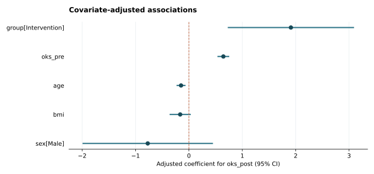

# Synthetic clinical cohort examples / 模拟临床队列示例

All records in this folder were generated by `medcohortkit.demo.synthetic_cohort` with seed **20261022**. They are artificial and are not derived from real patient records. Numerical findings demonstrate software behavior and have no clinical evidentiary value.

| Example | Data structure | Analysis |
| --- | --- | --- |
| [independent](independent/) | 160 subjects, one observation each | Table 1, Welch/Fisher comparisons, BH adjustment, HC3 linear model, ICC |
| [clustered](clustered/) | 160 subjects, 176 observations; 16 subjects contribute two knees | Row-based Table 1 and patient-clustered linear model; no independent group tests or row-bootstrap ICC |

The same first-knee observations appear in both examples. The clustered dataset adds 16 simulated second knees. Missing values are deliberately included to demonstrate analysis-specific exclusions.

## Browse the files

- [Independent input CSV](independent/synthetic_cohort.csv), [configuration](independent/analysis.json), [numeric audit](independent/results/audit.json).
- [Clustered input CSV](clustered/synthetic_cohort.csv), [configuration](clustered/analysis.json), [numeric audit](clustered/results/audit.json).
- Download or clone the repository, then open either `results/report.html` in a browser. Keep `forest.svg` in the same folder as the report. GitHub displays HTML source rather than executing the report.

### Example coefficient plot



The coefficients above are calculated from synthetic data. The graphic is not a clinical study result.

## Reproduce

From an installed copy of the repository:

```bash
python -m medcohortkit demo --out output/demo
```

Or rerun one committed input and configuration:

```bash
python -m medcohortkit analyze --data examples/independent/synthetic_cohort.csv --config examples/independent/analysis.json --out output/independent-rerun
```

Each run uses a new output directory. Random data and bootstrap seeds are fixed; run timestamps and dependency versions are recorded separately in the audit.

## 中文说明

`independent` 是一人一条记录的示例；`clustered` 在相同的 160 个模拟患者中加入 16 条第二膝记录。请保留双膝相同的 `patient_id`，不能以不同的 `knee_id` 代替患者编号来宣称观测独立。软件会报告各个分析实际纳入的数据数量。
